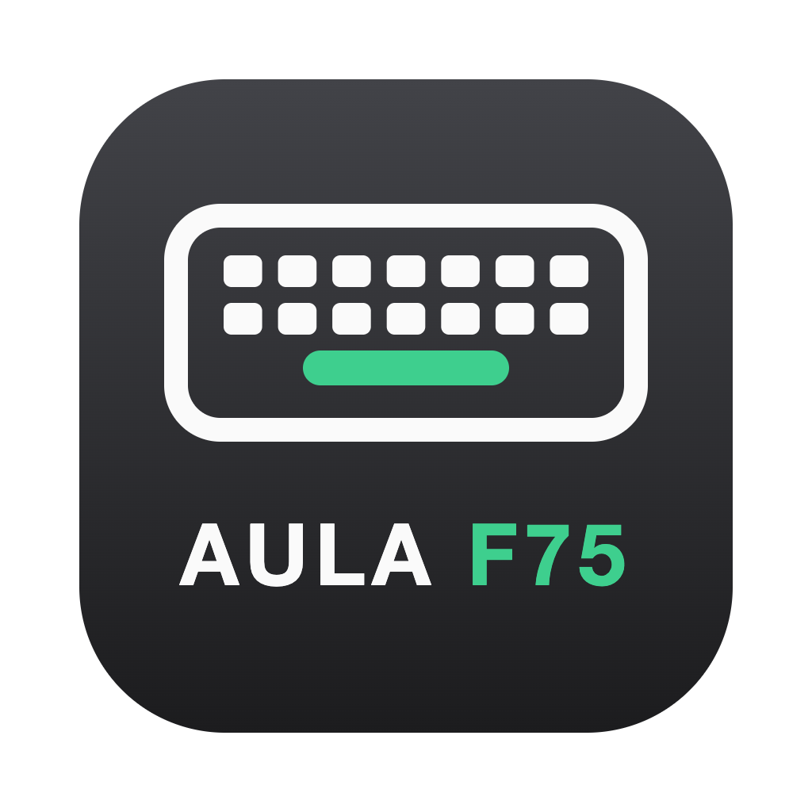

<p align="center">
  
</p>

<h1 align="center">AULA F75 Mac Driver</h1>

<p align="center">
  Customise the AULA F75 keyboard on macOS: lighting, music visualiser, macros and keyboard settings,<br />
  without needing the Windows-only vendor app.
</p>

---

## What you can do

- **Live lighting:** static, breathing, spectrum, wave and per-key colours, driven by the app in real time.
- **Music visualiser:** the keyboard lights up to whatever your Mac is playing, in three styles (Horizontal, Heat bars, Rainbow bars). Only the Mac's sound output is used: no microphone, nothing is recorded.
- **Saved effects:** read and change the effects stored on the keyboard itself (the ones you cycle with Fn), including brightness, speed and colour. Changes apply straight away.
- **2.4 GHz dongle support:** live lighting and Music also stream wirelessly through the USB dongle.
- **Macros:** press a shortcut anywhere on your Mac and the app types text for you. Import and export them as `.json` or `.txt` files.
- **Keyboard settings:** sleep timer and debounce, written over the USB cable.
- **Menu bar:** the app keeps running in the menu bar after you close its window. From there you can pause or resume it and switch lighting modes.
- **Languages:** English, French, Spanish and Chinese (translations in progress).

## Requirements

- macOS 13 Ventura or later (Apple Silicon or Intel)
- An AULA F75 connected by USB cable or through its 2.4 GHz dongle

## Installing

1. Download the latest `.dmg` from the [Releases](https://github.com/Itzadetunji/aula-f75-mac-driver/releases) page.
2. Drag **AULA F75 Mac Driver** into Applications and open it.
3. Follow the short setup (it asks which right-hand keys your F75 has).

macOS asks for permissions the first time you use certain features:

| Feature | Permission |
| --- | --- |
| Macros | Accessibility (so the app can type for you) |
| Music | Screen & System Audio Recording (audio only) |

## How it works

The app is made of two parts that talk to each other:

```
┌───────────────────────────┐   JSON lines over stdio   ┌───────────────────────────┐
│  Electron app (TypeScript) │ ◀──────────────────────▶ │  f75-helper (Swift)       │
│  UI, effects, macros,      │                          │  USB HID, audio capture,  │
│  settings, translations    │                          │  typing, menu bar         │
└───────────────────────────┘                          └─────────────┬─────────────┘
                                                                     │ IOKit HID
                                                               AULA F75 / dongle
```

- **Electron app** (`src/`): the window (React + Tailwind + shadcn/ui), and the main process that renders lighting effects frame by frame, registers macro shortcuts and stores your preferences.
- **Swift helper** (`native/f75-helper/`): a small command-line program that does everything that needs native macOS APIs:
  - talks to the keyboard over USB HID (IOKit)
  - captures system audio and turns it into a 16-band spectrum (ScreenCaptureKit + Accelerate)
  - types macro text (CGEvent)
  - draws the native menu bar item (AppKit)

### Talking to the keyboard

- **USB cable:** the keyboard takes 520-byte feature reports. Live lighting sends a full frame of per-key colours. Saved effects and settings live on a 128-byte settings page that the helper reads, patches and reads back to check the write stuck.
- **2.4 GHz dongle:** only live lighting is sent over the radio, in small 20-byte packets. For it to show, the keyboard must be on its **Fixed on** effect, otherwise its own animation paints over the stream.

The protocol was worked out by reading the keyboard's replies (see the dev-only **Protocol lab** tab) and from other open-source F75 projects.

### Safety rules

Writing bad data to a keyboard's settings can brick it, so the helper is deliberately strict:

- Only bytes whose meaning is confirmed can be written; everything else is refused.
- Settings are **never** written over the dongle: radio writes are known to have bricked another F75.
- Live lighting is capped at about 20 frames per second. Faster rates starve the keyboard's key scanning and cause missed keypresses.

## Development

You need [Bun](https://bun.sh) and Xcode (or the Xcode Command Line Tools, for Swift).

```bash
bun install
bun run dev        # builds the Swift helper, then starts the app with hot reload
bun run typecheck  # TypeScript checks for the main and renderer processes
```

### Building a DMG

```bash
bun run dist       # builds everything and writes the DMG to dist/
bun run package    # same, but stops at an unpacked .app (quicker for testing)
```

If a **Developer ID Application** certificate is in your keychain, the app is signed automatically. To notarize the DMG:

```bash
xcrun notarytool store-credentials "f75-notary" --apple-id "you@example.com" --team-id "TEAMID" --password "app-specific-password"
xcrun notarytool submit dist/*.dmg --keychain-profile "f75-notary" --wait
xcrun stapler staple dist/*.dmg
```

### Project layout

```
src/
  main/            Electron main process: effects loop, IPC, macros, menu bar contents
  preload/         Safe bridge between the window and the main process
  renderer/src/    React UI (pages in components/, hooks in hooks/)
  shared/          Code used by both sides: effects, protocol helpers, types
    locales/       Translation files (en, fr, es, zh)
native/f75-helper/ Swift helper (HID, audio, typing, menu bar)
build/             App icon and logo (logo.svg is the editable source)
```

## Contributing

Contributions are welcome, especially from other F75 owners: different firmware versions and layouts help a lot.

### Getting started

1. Fork the repo and create a branch: `git checkout -b feature/short-description`.
2. Run `bun install` and `bun run dev`.
3. Make your change, then run `bun run typecheck` and test it on a real keyboard where possible.
4. Open a pull request describing what changed, why, and how you tested it (cable, dongle or both, and your keyboard's firmware version from **Settings → Device**).

### Guidelines

- **Never write unverified bytes to the keyboard.** If you've found a new setting, open an issue with your Protocol lab captures (before and after changing it with Fn) so it can be confirmed before any write is added to the helper's whitelist.
- **No settings writes over the dongle.** Keep new write features cable-only.
- **Keep it translatable.** Don't hard-code UI text: add it to `src/shared/locales/en.json` and use `t('key')` from `react-i18next`. Copy new keys into the other locale files in English if you can't translate them.
- **Match the existing style.** Small, readable components; shared logic in `src/shared/`; native work in the Swift helper rather than in Node.
- Keep pull requests focused on one change.

### Adding or improving a translation

1. Edit the matching file in `src/shared/locales/` (for example `fr.json`), translating the values and keeping the keys the same.
2. Keep placeholders like `{{count}}` and tags like `<kbd>…</kbd>` exactly as they are.
3. Keys ending in `_one` and `_other` are singular and plural forms. Languages without plurals (like Chinese) only need `_other`.
4. To add a new language, create its JSON file and register it in `src/shared/i18n.ts`.

### Reporting bugs

Open an issue with:

- your macOS version and Mac model
- how the keyboard is connected (cable or dongle)
- the firmware version shown in **Settings → Device**
- what you expected, what happened, and steps to reproduce

## Disclaimer

This is an independent project and isn't affiliated with or endorsed by AULA. Changing keyboard settings is at your own risk, although the app only writes settings it has confirmed to be safe.
